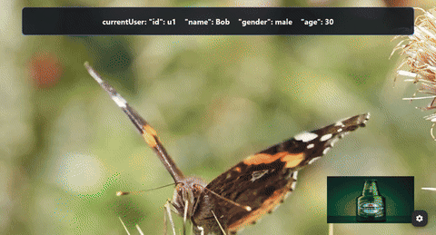

<header class="academic-header">
<h1 class="academic-title">NCL Users API: gingaf support and new proposed user attribute for &lt;rule&gt;</h1>
<div class="academic-authors">
<div class="academic-author">
<div class="author-name">Alan L. V. Guedes</div>
<div class="author-inst">University of Reading</div>
</div>
<div class="academic-author">
<div class="author-name">Paulo Victor Borges</div>
<div class="author-inst">PUC-Rio</div>
</div>
<div class="academic-author">
<div class="author-name">Daniel Moraes</div>
<div class="author-inst">PUC-Rio</div>
</div>
<div class="academic-author">
<div class="author-name">Sergio Colcher</div>
<div class="author-inst">PUC-Rio</div>
</div>
</div>
<div class="academic-conference">WTVDI 2026</div>
<div class="academic-links">
<a class="academic-link-btn" href="assets/pdfs/main.pdf">
<svg class="link-icon" xmlns="http://www.w3.org/2000/svg" viewBox="0 0 24 24" width="20" height="20" fill="currentColor"><path d="M12 16L16 11H13V3H11V11H8L12 16ZM19 18H5V11H3V19C3 19.5523 3.44772 20 4 20H20C20.5523 20 21 19.5523 21 19V11H19V18Z"/></svg>
<span>Paper</span>
</a>
<a class="academic-link-btn" href="slides/">
<svg class="link-icon" xmlns="http://www.w3.org/2000/svg" viewBox="0 0 24 24" width="20" height="20" fill="currentColor"><path d="M13 21V23H11V21H3C2.44772 21 2 20.5523 2 20V4C2 3.44772 2.44772 3 3 3H21C21.5523 3 22 3.44772 22 4V20C22 20.5523 21.5523 21 21 21H13ZM4 5V19H20V5H4ZM10 7.5L16 12L10 16.5V7.5Z"/></svg>
<span>Slides</span>
</a>
<a class="academic-link-btn" href="https://github.com/alanlivio/gingaf">
<svg class="link-icon" xmlns="http://www.w3.org/2000/svg" viewBox="0 0 24 24" width="20" height="20" fill="currentColor"><path d="M12 .297c-6.63 0-12 5.373-12 12 0 5.303 3.438 9.8 8.205 11.385.6.113.82-.258.82-.577 0-.285-.01-1.04-.015-2.04-3.338.724-4.042-1.61-4.042-1.61C4.422 18.07 3.633 17.7 3.633 17.7c-1.087-.744.084-.729.084-.729 1.205.084 1.838 1.236 1.838 1.236 1.07 1.835 2.809 1.305 3.495.998.108-.776.417-1.305.76-1.605-2.665-.3-5.466-1.332-5.466-5.93 0-1.31.465-2.38 1.235-3.22-.135-.303-.54-1.523.105-3.176 0 0 1.005-.322 3.3 1.23.96-.267 1.98-.399 3-.405 1.02.006 2.04.138 3 .405 2.28-1.552 3.285-1.23 3.285-1.23.645 1.653.24 2.873.12 3.176.765.84 1.23 1.91 1.23 3.22 0 4.61-2.805 5.625-5.475 5.92.42.36.81 1.096.81 2.22 0 1.606-.015 2.896-.015 3.286 0 .315.21.69.825.57C20.565 22.092 24 17.592 24 12.297c0-6.627-5.373-12-12-12"/></svg>
<span>Software Code</span>
</a>
<a class="academic-link-btn" href="https://github.com/alanlivio/paper-gingaf-multiuser">
<svg class="link-icon" xmlns="http://www.w3.org/2000/svg" viewBox="0 0 24 24" width="20" height="20" fill="currentColor"><path d="M12 .297c-6.63 0-12 5.373-12 12 0 5.303 3.438 9.8 8.205 11.385.6.113.82-.258.82-.577 0-.285-.01-1.04-.015-2.04-3.338.724-4.042-1.61-4.042-1.61C4.422 18.07 3.633 17.7 3.633 17.7c-1.087-.744.084-.729.084-.729 1.205.084 1.838 1.236 1.838 1.236 1.07 1.835 2.809 1.305 3.495.998.108-.776.417-1.305.76-1.605-2.665-.3-5.466-1.332-5.466-5.93 0-1.31.465-2.38 1.235-3.22-.135-.303-.54-1.523.105-3.176 0 0 1.005-.322 3.3 1.23.96-.267 1.98-.399 3-.405 1.02.006 2.04.138 3 .405 2.28-1.552 3.285-1.23 3.285-1.23.645 1.653.24 2.873.12 3.176.765.84 1.23 1.91 1.23 3.22 0 4.61-2.805 5.625-5.475 5.92.42.36.81 1.096.81 2.22 0 1.606-.015 2.896-.015 3.286 0 .315.21.69.825.57C20.565 22.092 24 17.592 24 12.297c0-6.627-5.373-12-12-12"/></svg>
<span>LaTeX/Website Code</span>
</a>
</div>
</header>

<div class="abstract-container" markdown="1">
<div class="abstract-inner" markdown="1">

## Abstract

Next-generation digital television standards (TV 3.0) require seamless multi-device interaction and multi-user personalization. In this paper, we present <span style="font-variant: small-caps;">gingaf-multiuser</span>, an extended implementation of the NCL Users API specified in ABNT NBR 25608. By integrating user profile management and multi-user event synchronization at both the document logic engine (`ncl_doc`) and visual widget presentation layer (`gingaf`), we enable collaborative and personalized interactive multimedia applications.

</div>
</div>

## Overview

`gingaf-multiuser` implements the NCL Users API (ABNT NBR 25608) to enable multi-screen synchronization and user personalization across TV 3.0 digital interactive broadcasts.

## Key Highlights

- **NCL Users API Core**: Implements `NCLUser` profile properties and `Users` context in `ncl_doc`.
- **Multi-Screen Property Routing**: Dynamic active user state resolution across companion displays.
- **Visual Widget Synchronization**: Reactive user context changes updating layout regions and targeted ad insertion in `gingaf`.

## Selected Applications

<table>
  <tbody>
    <tr>
      <td align="center">
        <br />
        NCL with multi-user profile switching and targeted advertising (<a href="https://ginga.org.br/gingaf/playground/?app=multiuser_profile/main.ncl">multiuser_profile/main.ncl</a>)
      </td>
    </tr>
  </tbody>
</table>

## Citation

```bibtex
@inproceedings{gingaf_multiuser2026,
  author    = {Guedes, Alan L. V. and Borges, Paulo Victor and Moraes, Daniel and Colcher, Sergio},
  title     = {NCL Users API: gingaf support and new proposed user attribute for <rule>},
  booktitle = {Anais Estendidos do XXXII Simpósio Brasileiro de Sistemas Multimídia e Web (WTVDI 2026)},
  location  = {Lavras, Brazil},
  year      = {2026},
  doi       = {10.5753/webmedia.2026.gingaf-multiuser}
}
```

<footer class="academic-footer md-typeset">
<p>Built with <a href="https://zensical.org" rel="nofollow">Zensical</a> based on <a href="https://research-template.roman.technology" rel="nofollow">Roman Hauksson-Neill's project page template</a></p>
</footer>
