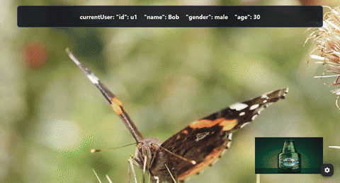

<header class="academic-header" markdown="1">
<h1 class="academic-title">NCL Users API: gingaf support and new proposed user attribute for &lt;rule&gt;</h1>
<div class="academic-authors">
<div class="academic-author">
<div class="author-name">Alan L. V. Guedes</div>
<div class="author-inst">University of Reading</div>
</div>
<div class="academic-author">
<div class="author-name">Paulo Victor Borges</div>
<div class="author-inst">PUC-Rio</div>
</div>
<div class="academic-author">
<div class="author-name">Daniel Moraes</div>
<div class="author-inst">PUC-Rio</div>
</div>
<div class="academic-author">
<div class="author-name">Sergio Colcher</div>
<div class="author-inst">PUC-Rio</div>
</div>
</div>
<div class="academic-conference">WTVDI 2026</div>
<div class="academic-links" markdown="span">
<a class="academic-link-btn" href="https://doi.org/10.5753/webmedia_estendido.2026.34167">
:simple-doi: <span>DOI</span>
</a>
<a class="academic-link-btn" href="assets/pdfs/main.pdf">
:lucide-download: <span>Pre-print</span>
</a>
<a class="academic-link-btn" href="slides/">
:lucide-presentation: <span>Slides</span>
</a>
<a class="academic-link-btn" href="https://github.com/alanlivio/gingaf">
:simple-github: <span>Code Repo</span>
</a>
<a class="academic-link-btn" href="https://github.com/alanlivio/paper-gingaf-multiuser">
:simple-github: <span>Paper Repo</span>
</a>
</div>
</header>

<div class="abstract-container" markdown="1">
<div class="abstract-inner" markdown="1">

## Abstract

Next-generation digital television standards (TV 3.0) require seamless multi-device interaction and multi-user personalization. In this paper, we present <span style="font-variant: small-caps;">gingaf-multiuser</span>, an extended implementation of the NCL Users API specified in ABNT NBR 25608. By integrating user profile management and multi-user event synchronization at both the document logic engine (`ncl_doc`) and visual widget presentation layer (`gingaf`), we enable collaborative and personalized interactive multimedia applications.

</div>
</div>

## Overview

`gingaf-multiuser` implements the NCL Users API (ABNT NBR 25608) to enable multi-screen synchronization and user personalization across TV 3.0 digital interactive broadcasts.

## Key Highlights

- **NCL Users API Core**: Implements `NCLUser` profile properties and `Users` context in `ncl_doc`.
- **Multi-Screen Property Routing**: Dynamic active user state resolution across companion displays.
- **Visual Widget Synchronization**: Reactive user context changes updating layout regions and targeted ad insertion in `gingaf`.

## Selected Applications

<table>
  <tbody>
    <tr>
      <td align="center">
        <br />
        NCL with multi-user profile switching and targeted advertising (<a href="https://ginga.org.br/gingaf/playground/?app=multiuser_profile/main.ncl">multiuser_profile/main.ncl</a>)
      </td>
    </tr>
  </tbody>
</table>

## Citation

```bibtex
@inproceedings{gingaf_multiuser2026,
  author    = {Guedes, Alan L. V. and Borges, Paulo Victor and Moraes, Daniel and Colcher, Sergio},
  title     = {NCL Users API: gingaf support and new proposed user attribute for <rule>},
  booktitle = {Anais Estendidos do XXXII Simpósio Brasileiro de Sistemas Multimídia e Web (WTVDI 2026)},
  location  = {Lavras, Brazil},
  year      = {2026},
  pages     = {261--263},
  publisher = {SBC},
  address   = {Porto Alegre, RS, Brasil},
  doi       = {10.5753/webmedia_estendido.2026.34167},
  url       = {https://doi.org/10.5753/webmedia_estendido.2026.34167}
}
```

<footer class="academic-footer md-typeset">
<p>Built with <a href="https://zensical.org" rel="nofollow">Zensical</a> based on <a href="https://research-template.roman.technology" rel="nofollow">Roman Hauksson-Neill's project page template</a></p>
</footer>
