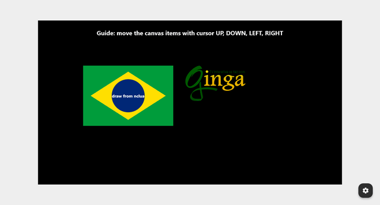
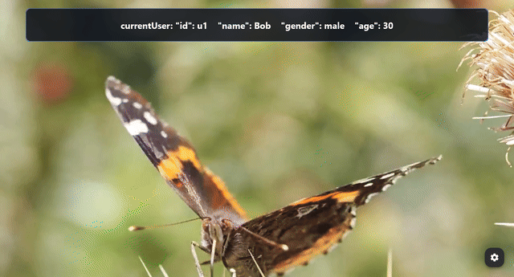
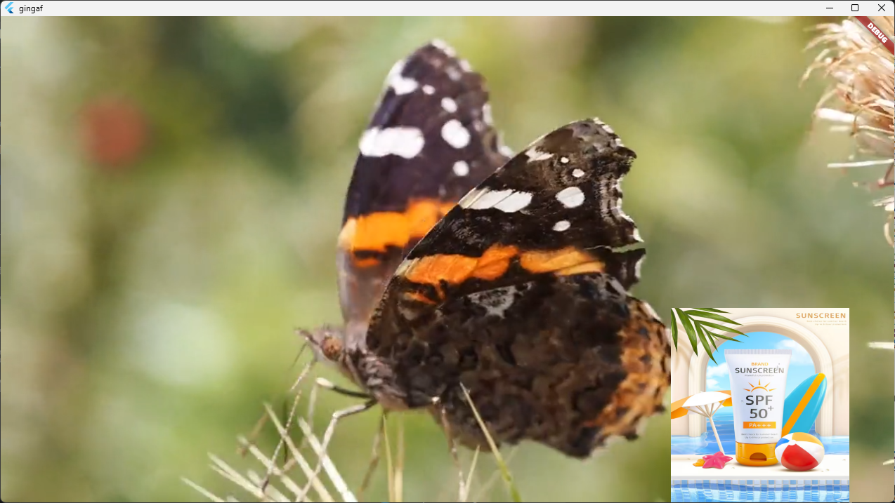
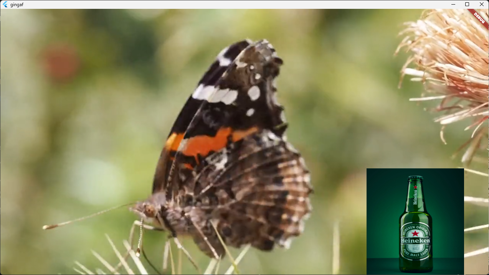

<style>
.grayscale {
  filter: grayscale(100%);
}
.grid-2x2 {
  display: grid;
  grid-template-columns: repeat(2, 1fr);
  grid-gap: 14px 28px;
  width: 100%;
  margin-top: 8px;
}
.grid-card {
  display: flex;
  flex-direction: column;
  align-items: center;
  text-align: center;
}
.grid-card img {
  width: 100%;
  max-height: 165px;
  object-fit: contain;
  border-radius: 6px;
  border: 1px solid transparent;
  background-color: transparent;
  box-shadow: none;
}
.grid-card p {
  margin: 6px 0 0 0;
  font-size: 18px;
  font-weight: 600;
  line-height: 1.3;
  color: #1f2328;
}
.grid-card a {
  color: #0969da;
  font-weight: 700;
  text-decoration: underline;
}
pre {
  font-size: 15px;
  line-height: 1.25;
}
</style>

<!--
_paginate: false
_header: ""
-->

<div style="display: grid; grid-template-columns: 3fr 1fr; align-items: center;">

<div>

# NCL Users API: gingaf Support and New Proposed User Attribute for &lt;rule&gt;

**Alan L. V. Guedes**$^1$, **Paulo Victor Borges**$^2$, **Daniel Moraes**$^2$, **Sergio Colcher**$^2$
$^1$University of Reading, UK | $^2$PUC-Rio, BR

*XXXII Simpósio Brasileiro de Sistemas Multimídia e Web (WebMedia 2026)*

**Website do Artigo (slides, código, demo)**:
https://alanlivio.github.io/paper-webmedia26-multiuser/

</div>

<div style="display: flex; flex-direction: column; justify-content: center;">


</div>

</div>

---

# Agenda

- **Contexto e Definição do Problema**
- **Funcionalidades e Demo do gingaf**
- **Suporte Multiusuário no gingaf**
- **Extensão Proposta para NCL**
- **Considerações Finais**

---

<!-- _class: invert -->
<!-- _paginate: skip -->

# Contexto e Definição do Problema

---

# Contexto: A Mudança de Paradigma da TV 3.0

**De STBs de telespectador único para salas de estar multiusuário**
- Convergência broadcast-broadband, dispositivos de segunda tela e TV personalizada.
- Múltiplos membros da família assistem à tela principal compartilhada acompanhados por smartphones e tablets.

**Limitação do Ginga-NCL Legado (TV 2.0 / 2.5)**
- Contexto gerenciado unicamente por variáveis globais de `system` (`system.language`, `system.caption`).
- Modificações afetam todos os telespectadores globalmente, impedindo a personalização individualizada.

---

# Padrão TV 3.0: A API de Usuários do NCL

**Padronização**
- Padronizada na norma SBTVD ABNT 25608 para a TV Digital de Nova Geração.

**Novos Elementos XML**
- `<userBase>`: Contêiner para definições de perfis de usuários ativos.
- `<userProfile>`: Representa perfis de telespectadores; suporta consultas JSON externas via `src`.
- `<settings user="...">`: Vincula atributos de perfil de usuário específicos a propriedades NCL.
- Links com avaliação causal: Avaliam atributos de usuário (ex.: `gender`, `age`) para conduzir a apresentação.

---

<!-- _class: invert -->
<!-- _paginate: skip -->

# Funcionalidades e Demo do gingaf

---

## NCL com Links, Grade de Vídeos, NCL Embutido e Navegação

<div class="grid-2x2">
  <div class="grid-card">
    
    <p>NCL com links básicos (<a href="https://ginga-org-br.github.io/gingaf/playground/?app=video.ncl">video.ncl</a>)</p>
  </div>
  <div class="grid-card">
    
    <p>NCL com grade de vídeos (<a href="https://ginga-org-br.github.io/gingaf/playground/?app=video_grid.ncl">video_grid.ncl</a>)</p>
  </div>
  <div class="grid-card">
    
    <p>NCL embutido em NCL (<a href="https://ginga-org-br.github.io/gingaf/playground/?app=emb_ncl.ncl">emb_ncl.ncl</a>)</p>
  </div>
  <div class="grid-card">
    
    <p>NCL com navegação de foco e seleção (<a href="https://ginga-org-br.github.io/gingaf/playground/?app=focus_nav.ncl">focus_nav.ncl</a>)</p>
  </div>
</div>

---

## NCLua, HTML+CCWS, HTML Embutido e Multiusuário

<div class="grid-2x2">
  <div class="grid-card">
    
    <p>NCL com desenho em tela Lua e teclas (<a href="https://ginga-org-br.github.io/gingaf/playground/?app=lua_canvas.ncl">lua_canvas.ncl</a>)</p>
  </div>
  <div class="grid-card">
    
    <p>HTML com CCWS /current-service/ (<a href="https://ginga-org-br.github.io/gingaf/playground/?app=current_service.html">current_service.html</a>)</p>
  </div>
  <div class="grid-card">
    
    <p>NCL com documento HTML embutido (<a href="https://ginga-org-br.github.io/gingaf/playground/?app=emb_html.ncl">emb_html.ncl</a>)</p>
  </div>
  <div class="grid-card">
    
    <p>NCL com troca de perfil multiusuário e publicidade direcionada (<a href="https://ginga-org-br.github.io/gingaf/playground/?app=multiuser_profile/main.ncl">multiuser_profile/main.ncl</a>)</p>
  </div>
</div>

---

## NCL Multiusuário

<div class="grid-card" style="margin-top: 24px;">
  
  <p style="margin-top: 14px; font-size: 22px;">NCL com troca de perfil multiusuário e publicidade direcionada (<a href="https://ginga-org-br.github.io/gingaf/playground/?app=multiuser_profile/main.ncl">multiuser_profile/main.ncl</a>)</p>
</div>

---

<!-- _class: invert -->

# Suporte Multiusuário no gingaf

---

# Mídia Setting de Usuário: currentUser

**Atualiza automaticamente propriedades** `<media>` do typo Settings para o usuario

```xml
<media id="uSettings" type="application/x-ncl-user-settings" user="currentUser">
  <property name="id"/>
  <property name="name"/>
  <property name="gender"/>
  <property name="age"/>
</media>
```

---

# Mídia Setting de Usuário: currentUser

## Exemplo de NCLua reativo ao usuário:

```xml
<link xconnector="onBeginOrAttributionSet">
  <bind role="onBegin" component="mVideo"/>
  <bind role="onEndAttribution" component="uSettings" interface="id"/>
  <bind role="get1" component="uSettings" interface="id"/>
  <bind role="get2" component="uSettings" interface="name"/>
  <bind role="get3" component="uSettings" interface="gender"/>
  <bind role="get4" component="uSettings" interface="age"/>
  <bind role="set" component="mUserLua" interface="userId">
    <bindParam name="var" value="$get1"/>
  </bind>
  <bind role="set" component="mUserLua" interface="userName">
    <bindParam name="var" value="$get2"/>
  </bind>
  <bind role="set" component="mUserLua" interface="userGender">
    <bindParam name="var" value="$get3"/>
  </bind>
  <bind role="set" component="mUserLua" interface="userAge">
    <bindParam name="var" value="$get4"/>
  </bind>
</link>
```

---

## Exemplo de NCLua reativo ao usuario:

<div class="grid-card" style="margin-top: 24px;">
  
  <p style="margin-top: 14px; font-size: 22px;">NCL com usuário atual e sincronização com Lua (<a href="https://ginga-org-br.github.io/gingaf/playground/?app=multiuser_current/main.ncl">multiuser_current/main.ncl</a>)</p>
</div>

---

# Base de Usuários e Perfis Declarativos

- **Registro Centralizado**: Máquina de estados headless resolve e armazena em cache os perfis ativos.
- **Seleção Dinâmica via JSON**: Avaliação de consultas declarativas (`adult_query.json`).

```xml
<userBase>
  <userProfile id="pAdult" src="adult_query.json" max="1"/>
</userBase>

...

<media id="uSettings" type="application/x-ncl-user-settings" user="currentUser">
  <property name="id"/>
  <property name="name"/>
  <property name="gender"/>
  <property name="age"/>
</media>
<media id="uAdult" type="application/x-ncl-user-settings" user="pAdult">
  <property name="gender"/>
</media>
```

---

# Caso de Uso: Publicidade Direcionada

**Adaptação Personalizada de Conteúdo**
- **Sem Usuário Adulto Masculino Ativo**: Exibe dinamicamente o banner comercial geral (`ad_general.png`).
- **Com Usuário Adulto Masculino Ativo**: Seleciona e renderiza dinamicamente o banner direcionado (`ad_male.png`).

<div style="display: flex; gap: 24px; justify-content: center; margin-top: 15px;">
  <div style="text-align: center;">
    
    <p style="font-size: 15px; margin-top: 6px; color: #555;">(a) Sem usuário adulto masculino (anúncio geral)</p>
  </div>
  <div style="text-align: center;">
    
    <p style="font-size: 15px; margin-top: 6px; color: #555;">(b) Com usuário adulto masculino (anúncio direcionado)</p>
  </div>
</div>

---

# Caso de Uso: Publicidade Direcionada

<div class="grid-card" style="margin-top: 24px;">
  
  <p style="margin-top: 14px; font-size: 22px;">NCL com troca de perfil multiusuário e publicidade direcionada (<a href="https://ginga-org-br.github.io/gingaf/playground/?app=multiuser_profile/main.ncl">multiuser_profile/main.ncl</a>)</p>
</div>

---

<!-- _class: invert -->
<!-- _paginate: skip -->

# Extensão Proposta para NCL

---

# Limitação da Abordagem com Links Causais

- Conectores customizados com `<compoundCondition>` e `<assessmentStatement>` para cada teste.
- Exige múltiplos `<link>` para apresentação condicional.

```xml
<connectorBase>
  <causalConnector id="onBeginTestVarStart">
    <compoundCondition operator="and">
      <simpleCondition role="onBegin"/>
      <assessmentStatement comparator="eq">
        <attributeAssessment role="var" attributeType="nodeProperty" eventType="attribution"/>
        <valueAssessment value="$value"/>
      </assessmentStatement>
    </compoundCondition>
    <simpleAction role="start"/>
  </causalConnector>
</connectorBase>
```

---

# Solução Proposta: Atributo user para &lt;rule&gt;

**Estendendo Regras Declarativas Nativas do NCL**
- O NCL suporta nativamente `<switch>` e `<rule>` para adaptação de conteúdo.
- Proposta: Adicionar o atributo `user` aos elementos `<rule>`:

  ```xml
  <rule id="rAdultMale" user="pAdult" var="gender" comparator="eq" value="male"/>
  ```

**Seleção Declarativa via `<switch>`**
- Agrupa nós de mídia alternativos diretamente dentro de um único `<switch>`.
- Elimina definições de conectores e vinculações complexas com múltiplos links.
- Aprimora drasticamente a ergonomia de autoria e a manutenibilidade.

---

<!-- _class: invert -->
<!-- _paginate: skip -->

# Considerações Finais

---

# Considerações Finais

- Implementação completa em código aberto da API de Usuários NCL da TV 3.0 SBTVD no `gingaf`.
- Suporte arquitetural a perfis dinâmicos de usuário e avaliação reativa de propriedades.
- Proposta inovadora estendendo `<rule>` no NCL com o atributo `user` para seleção concisa via `<switch>`.
- Validado com casos de testes automatizados e cenários de aplicações multiusuário.

---

<!--
_paginate: false
_header: ""
-->

# Obrigado!

<div style="display: grid; grid-template-columns: 3fr 2fr; align-items: start;">

<div>

### Dúvidas e Discussão

- **Repositório**: https://github.com/ginga-org-br/gingaf
- **Sobre o Ginga**: https://ginga.org.br
- **Contato**: `a.guedes@reading.ac.uk` | `danielmoraes@telemidia.puc-rio.br`

</div>

<div style="display: flex; justify-content: center; align-items: flex-start;">


</div>

</div>
