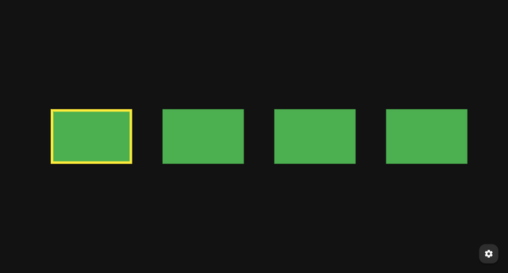
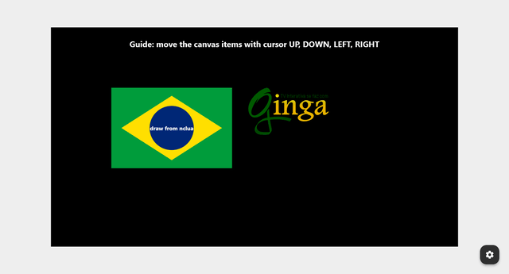
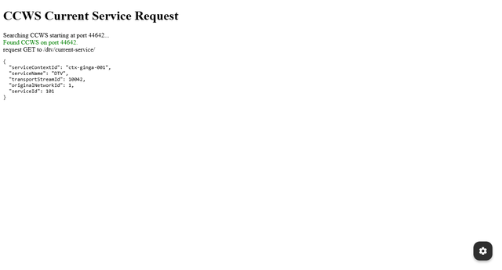
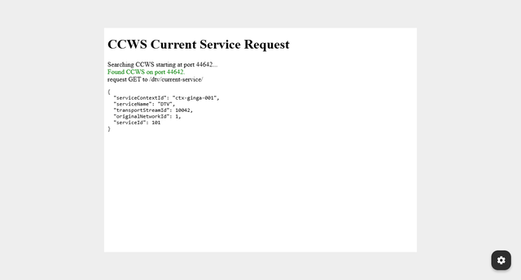
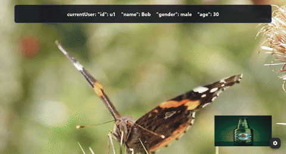
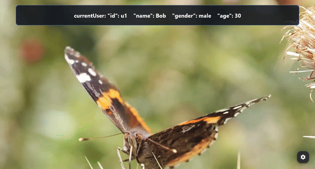
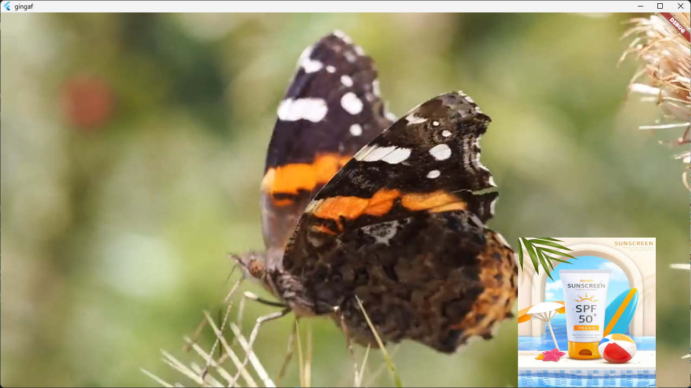
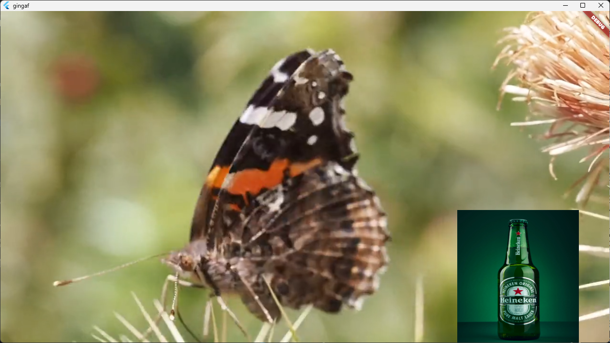
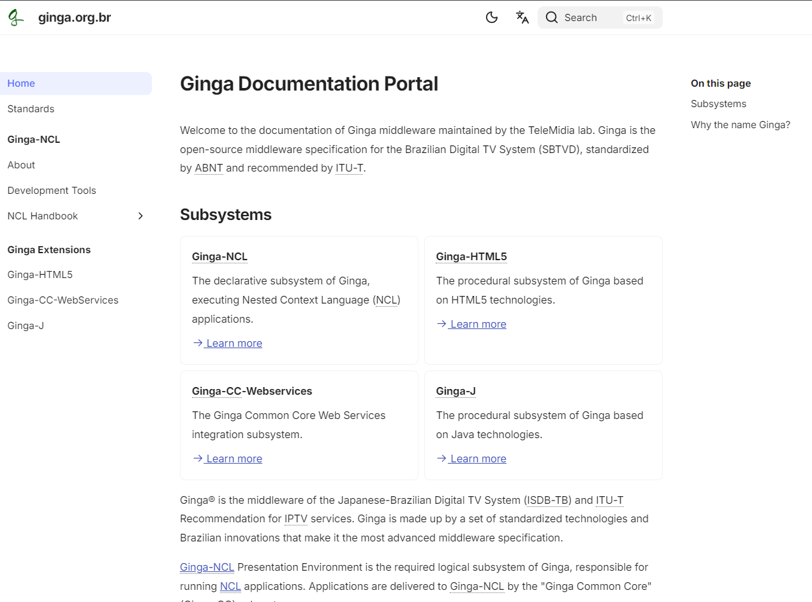

<!--
_paginate: false
_header: ""
_class: cols-3-1 vcenter
-->

- # NCL Users API: gingaf Support and New Proposed User Attribute for &lt;rule&gt;

  **Alan L. V. Guedes**$^1$, **Paulo Victor Borges**$^2$, **Daniel Moraes**$^2$, **Sergio Colcher**$^2$
  $^1$University of Reading, UK | $^2$PUC-Rio, BR

  *XXXII Simpósio Brasileiro de Sistemas Multimídia e Web (WebMedia 2026)*

  **Website do Artigo (slides, código, demo)**:
  https://alanlivio.github.io/paper-webmedia26-multiuser/

- 

  

  

---

# Agenda

- **Contexto e Definição do Problema**
- **Funcionalidades e Demo do gingaf**
- **Suporte Multiusuário no gingaf**
- **Extensão Proposta para NCL**
- **Considerações Finais**

---

<!-- _class: invert -->
<!-- _paginate: skip -->

# Contexto e Definição do Problema

---

# Contexto: A Mudança de Paradigma da TV 3.0

**De STBs de telespectador único para salas de estar multiusuário**
- Convergência broadcast-broadband, dispositivos de segunda tela e TV personalizada.
- Múltiplos membros da família assistem à tela principal compartilhada acompanhados por smartphones e tablets.

**Limitação do Ginga-NCL Legado (TV 2.0 / 2.5)**
- Contexto gerenciado unicamente por variáveis globais de `system` (`system.language`, `system.caption`).
- Modificações afetam todos os telespectadores globalmente, impedindo a personalização individualizada.

---

# Padrão TV 3.0: A API de Usuários do NCL

**Padronização**
- Padronizada na norma SBTVD ABNT 25608 para a TV Digital de Nova Geração.

**Novos Elementos XML**
- `<userBase>`: Contêiner para definições de perfis de usuários ativos.
- `<userProfile>`: Representa perfis de telespectadores; suporta consultas JSON externas via `src`.
- `<settings user="...">`: Vincula atributos de perfil de usuário específicos a propriedades NCL.
- Links com avaliação causal: Avaliam atributos de usuário (ex.: `gender`, `age`) para conduzir a apresentação.

---

<!-- _class: invert -->
<!-- _paginate: skip -->

# Funcionalidades e Demo do gingaf

---

<!-- _class: grid-2x2 center -->

## NCL com Links, Grade de Vídeos, NCL Embutido e Navegação

- 
  NCL com links básicos ([video.ncl](https://ginga.org.br/gingaf/playground/?app=video.ncl))

- 
  NCL com grade de vídeos ([video_grid.ncl](https://ginga.org.br/gingaf/playground/?app=video_grid.ncl))

- 
  NCL embutido em NCL ([emb_ncl.ncl](https://ginga.org.br/gingaf/playground/?app=emb_ncl.ncl))

- 
  NCL com navegação de foco e seleção ([focus_nav.ncl](https://ginga.org.br/gingaf/playground/?app=focus_nav.ncl))

---

<!-- _class: grid-2x2 center -->

## NCLua, HTML+CCWS, HTML Embutido e Multiusuário

- 
  NCL com desenho em tela Lua e teclas ([lua_canvas.ncl](https://ginga.org.br/gingaf/playground/?app=lua_canvas.ncl))

- 
  HTML com CCWS /current-service/ ([current_service.html](https://ginga.org.br/gingaf/playground/?app=current_service.html))

- 
  NCL com documento HTML embutido ([emb_html.ncl](https://ginga.org.br/gingaf/playground/?app=emb_html.ncl))

- 
  NCL com troca de perfil multiusuário ([multiuser_profile/main.ncl](https://ginga.org.br/gingaf/playground/?app=multiuser_profile/main.ncl))

---

<!-- _class: center -->

## NCL Multiusuário

- 
  NCL com troca de perfil multiusuário e publicidade direcionada ([multiuser_profile/main.ncl](https://ginga.org.br/gingaf/playground/?app=multiuser_profile/main.ncl))

---

<!-- _class: invert -->

# Suporte Multiusuário no gingaf

---

# Mídia Setting de Usuário: currentUser

**Atualiza automaticamente propriedades** `<media>` do tipo Settings para o usuário

```xml
<media id="uSettings" type="application/x-ncl-user-settings" user="currentUser">
  <property name="id"/>
  <property name="name"/>
  <property name="gender"/>
  <property name="age"/>
</media>
```

---

# Mídia Setting de Usuário: currentUser

## Exemplo de NCLua reativo ao usuário:

```xml
<link xconnector="onBeginOrAttributionSet">
  <bind role="onBegin" component="mVideo"/>
  <bind role="onEndAttribution" component="uSettings" interface="id"/>
  <bind role="get1" component="uSettings" interface="id"/>
  <bind role="get2" component="uSettings" interface="name"/>
  <bind role="get3" component="uSettings" interface="gender"/>
  <bind role="get4" component="uSettings" interface="age"/>
  <bind role="set" component="mUserLua" interface="userId">
    <bindParam name="var" value="$get1"/>
  </bind>
  <bind role="set" component="mUserLua" interface="userName">
    <bindParam name="var" value="$get2"/>
  </bind>
  <bind role="set" component="mUserLua" interface="userGender">
    <bindParam name="var" value="$get3"/>
  </bind>
  <bind role="set" component="mUserLua" interface="userAge">
    <bindParam name="var" value="$get4"/>
  </bind>
</link>
```

---

<!-- _class: center -->

## Exemplo de NCLua reativo ao usuário:

- 
  NCL com usuário atual e sincronização com Lua ([multiuser_current/main.ncl](https://ginga.org.br/gingaf/playground/?app=multiuser_current/main.ncl))

---

# Base de Usuários e Perfis Declarativos

- **Registro Centralizado**: Máquina de estados headless resolve e armazena em cache os perfis ativos.
- **Seleção Dinâmica via JSON**: Avaliação de consultas declarativas (`adult_query.json`).

```xml
<userBase>
  <userProfile id="pAdult" src="adult_query.json" max="1"/>
</userBase>

...

<media id="uSettings" type="application/x-ncl-user-settings" user="currentUser">
  <property name="id"/>
  <property name="name"/>
  <property name="gender"/>
  <property name="age"/>
</media>
<media id="uAdult" type="application/x-ncl-user-settings" user="pAdult">
  <property name="gender"/>
</media>
```

---

<!-- _class: cols-2 center -->

# Caso de Uso: Publicidade Direcionada

**Adaptação Personalizada de Conteúdo**: exibe o anúncio geral (`ad_general.png`) sem usuário adulto masculino ativo, ou o anúncio direcionado (`ad_male.png`) quando ativo.

- 
  (a) Sem usuário adulto masculino (anúncio geral)

- 
  (b) Com usuário adulto masculino (anúncio direcionado)

---

<!-- _class: center -->

# Caso de Uso: Publicidade Direcionada

- 
  NCL com troca de perfil multiusuário e publicidade direcionada ([multiuser_profile/main.ncl](https://ginga.org.br/gingaf/playground/?app=multiuser_profile/main.ncl))

---

<!-- _class: invert -->
<!-- _paginate: skip -->

# Extensão Proposta para NCL

---

# Limitação da Abordagem com Links Causais

- Conectores customizados com `<compoundCondition>` e `<assessmentStatement>` para cada teste.
- Exige múltiplos `<link>` para apresentação condicional.

```xml
<connectorBase>
  <causalConnector id="onBeginTestVarStart">
    <compoundCondition operator="and">
      <simpleCondition role="onBegin"/>
      <assessmentStatement comparator="eq">
        <attributeAssessment role="var" attributeType="nodeProperty" eventType="attribution"/>
        <valueAssessment value="$value"/>
      </assessmentStatement>
    </compoundCondition>
    <simpleAction role="start"/>
  </causalConnector>
</connectorBase>
```

---

# Solução Proposta: Atributo user para &lt;rule&gt;

**Estendendo Regras Declarativas Nativas do NCL**
- O NCL suporta nativamente `<switch>` e `<rule>` para adaptação de conteúdo.
- Proposta: Adicionar o atributo `user` aos elementos `<rule>`:

  ```xml
  <rule id="rAdultMale" user="pAdult" var="gender" comparator="eq" value="male"/>
  ```

**Seleção Declarativa via `<switch>`**
- Agrupa nós de mídia alternativos diretamente dentro de um único `<switch>`.
- Elimina definições de conectores e vinculações complexas com múltiplos links.
- Aprimora drasticamente a ergonomia de autoria e a manutenibilidade.

---

<!-- _class: invert -->
<!-- _paginate: skip -->

# Considerações Finais

---

# Considerações Finais

**Contribuições Principais**:
- **Implementação da API de Usuários NCL (TV 3.0)**: Suporte arquitetural em código aberto no `gingaf` com resolução dinâmica de perfis e vinculação reativa de propriedades.
- **Extensão da Linguagem NCL**: Proposta do atributo `user` para o elemento `<rule>`, permitindo apresentação adaptativa e concisa via `<switch>`.

**Validação**: Casos de testes automatizados e validação em cenários de aplicações multiusuário.

---

<!--
_paginate: false
_header: ""
_class: cols-2 vcenter
-->

# Obrigado!

- ### Dúvidas e Discussão

  **Repositório**: https://github.com/ginga-org-br/gingaf

  **Sobre o Ginga**: https://ginga.org.br

  **Contato**: `a.guedes@reading.ac.uk` | `danielmoraes@telemidia.puc-rio.br`

- 
